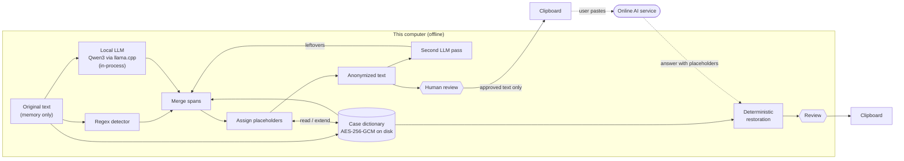

# Privacy architecture

This document describes how Hajde Ano keeps private case data on the local computer.

## Data flow

* The **original text** only exists in memory (the text box) and is never written to
  disk by the application.
* The **local LLM** runs in-process through LLamaSharp (llama.cpp). There is no server,
  no localhost port and no external process. The model only returns a JSON list of
  spans; the application checks that each span occurs in the text and performs all
  replacements itself.
* The **anonymized text** reaches the clipboard only after the user confirmed the review
  and resolved every uncertain detection.
* **Restoration** is a deterministic dictionary lookup. Unknown or modified
  placeholders are reported and left unchanged.

## What is stored, and how

| Data | Location | Protection |
|---|---|---|
| Case name, entity dictionary (original values ↔ placeholders), terms marked as not sensitive | `<data dir>/cases/<random id>.case` | AES-256-GCM. The case id is authenticated as associated data, so case files can't be swapped |
| Vault header (salt, iteration count, encrypted verifier) | `<data dir>/vault.json` | Contains no private data |
| Settings (model path, context size, categories) | `<data dir>/settings.json` | Contains no private data |
| Original documents, anonymized documents, AI answers | Nowhere | Kept in memory only |

The data directory is the per-user application data folder, e.g. `%APPDATA%\HajdeAno`
on Windows or `~/.config/HajdeAno` on Linux. The exact path is shown in *Settings*. It
can be overridden with `HAJDE_ANO_DATA_DIR`.

### Key management

The encryption key is derived from the user's password with PBKDF2-HMAC-SHA256
(600 000 iterations, 128-bit random salt). The key exists only in memory while the
vault is unlocked and is zeroed when the vault is locked or the application exits.
A lost password cannot be recovered.

The design also allows an OS-protected key (DPAPI on Windows, Keychain on macOS). We
chose a password-derived key because it works the same way on all platforms and
protects the data even against other processes of the same user.

### Writes and deletion

Case files are written to a temporary file in the same folder and then atomically
renamed. The temporary file only ever contains ciphertext. Deleting a case overwrites
the file with random bytes before removing it. On SSDs and copy-on-write file systems
this is best effort; the data is encrypted anyway.

## Offline guarantees

* The application contains no networking code. `dev/continuous_integration/check_offline.py`
  (run by the pre-commit script and in CI) fails if `src/` mentions HTTP clients,
  sockets, DNS, process spawning, telemetry or logging frameworks.
* If no model is found, the application shows a local error message and asks the user
  to select a file. It never downloads one.
* llama.cpp logging is disabled through a no-op log callback, so prompts are never
  printed.
* Unhandled exceptions print only the exception *type*, never messages that could echo
  private input. There is no crash reporter.
* .NET itself sends no runtime telemetry. (The .NET *SDK* CLI has telemetry, which only
  matters on developer machines; CI sets `DOTNET_CLI_TELEMETRY_OPTOUT`.)

To verify network isolation yourself, run the application with networking disabled,
e.g. `unshare -rn ./HajdeAno` on Linux or under a firewall rule that blocks the
executable on Windows and macOS. All features keep working.

## Remaining risks

* **Detection is probabilistic.** The model can miss names, especially rare ones or
  ones in unusual contexts. Mitigations: deterministic patterns, the case dictionary
  with fuzzy matching, a second pass over the anonymized text, recall-oriented prompts,
  and mandatory human review.
* **Clipboard.** Copied text is visible to other applications and to clipboard history
  tools (e.g. Windows clipboard history). Only approved anonymized text and restored
  text are copied, at the user's explicit request.
* **Swap and memory dumps.** Text in memory can be paged out by the operating system.
  Use full-disk encryption.
* **Indirect identifiers.** Even without names, a combination of details (rare
  diagnosis, small village, unusual events) can identify a person. Strict privacy mode
  replaces dates, amounts, nationalities and places, but the user remains responsible
  for the final text.
