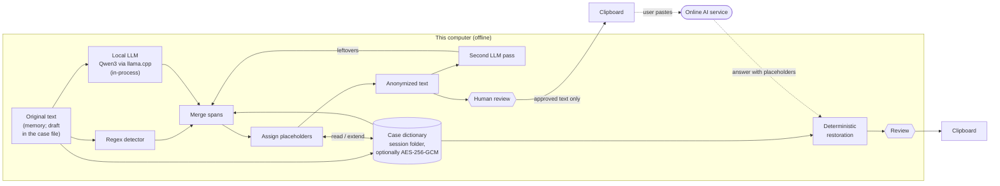

# Privacy architecture

This document describes how Hajde Ano keeps private case data on the local computer.

## Data flow

* The **original text** is kept in memory and, as an autosaved draft of the case, in the
  case file inside the session folder (encrypted if the session is).
* The **local LLM** runs in-process through LLamaSharp (llama.cpp). There is no server,
  no localhost port and no external process. The model only returns a JSON list of
  spans; the application checks that each span occurs in the text and performs all
  replacements itself.
* The **anonymized text** reaches the clipboard only after the user confirmed the review
  and resolved every uncertain detection.
* **Restoration** is a deterministic dictionary lookup. Unknown or modified
  placeholders are reported and left unchanged.

## What is stored, and how

| Data | Location | Protection |
|---|---|---|
| Case name, entity dictionary (original values ↔ placeholders), terms marked as not sensitive, the text of the case | Encrypted session: `<session folder>/cases/<case id>.case` | AES-256-GCM with a key derived from the password. The case id is authenticated as associated data, so case files can't be swapped. The file name is the random case id and reveals nothing |
| The same | Unencrypted session: `<session folder>/cases/<case id>.json` | **None** (plain JSON) |
| Session marker (format version; for encrypted sessions also salt, iteration count and an encrypted password check) | `<session folder>/hajde-ano-session.json` | Contains no private data. Validated when opening (bounded iteration count, salt size), so a damaged file is reported instead of crashing or hanging |
| Settings (model path, context size, categories) and the list of recent session folders | `<data dir>/settings.json` | The folder names of the sessions are visible here |
| Anonymized documents, AI answers, restored texts | Nowhere | Kept in memory only |

The **session folder** is chosen by the user when creating or opening a session, and
encryption is chosen when the session is created. Files and folders of a session are
created readable by the user only (mode 0600/0700 on Linux and macOS).

* In an **encrypted session**, one can still see, without the password, how many cases
  exist, their sizes and when they were last changed.
* In an **unencrypted session**, anyone who can read the folder can read the names and
  their placeholders. Choose a folder only you can access, ideally on a disk with
  full-disk encryption (BitLocker, FileVault, LUKS).

Either way, keep in mind that cloud-synced folders (OneDrive, iCloud Drive, Dropbox)
upload the case files.

### Key management (encrypted sessions)

The key is derived from the session password with PBKDF2-HMAC-SHA256 (600 000
iterations, 128-bit random salt); independent sub-keys for the password check and the
case files are derived with HKDF-SHA256. The key exists only in memory while the session
is open and is zeroed when the session is closed or the application exits. A lost
password cannot be recovered, and the cases are lost with it. The password cannot be
changed or removed later; create a new session for that.

The data directory is the per-user application data folder, e.g. `%APPDATA%\HajdeAno`
on Windows or `~/.config/HajdeAno` on Linux. Both paths are shown in *Settings*. The
data directory can be overridden with `HAJDE_ANO_DATA_DIR`.

### Writes and autosave

Every write goes to a temporary file in the same folder, which is flushed to the disk and
then renamed over the old file. A crash or power loss therefore leaves either the old or
the new file, never a mix. In an encrypted session, the temporary files contain only
ciphertext. Leftover temporary files are removed when the session is opened.

The text of the case is saved automatically 1 second after you stop typing, and at least
every 10 seconds while you keep typing, but only if it actually changed. A case file is
a few kilobytes up to some tens of kilobytes, so this is negligible for the disk: a
20 KB case saved every 10 seconds during 8 hours of continuous typing is about 60 MB a
day, while SSDs are rated for hundreds of terabytes written.

**Deletion.** Deleting a case deletes its file. Copies may remain in free disk blocks,
file system snapshots, backups or the sync history of cloud folders.

## Offline guarantees

* The application contains no networking code. `dev/continuous_integration/check_offline.py`
  (run by the pre-commit script and in CI) fails if `src/` mentions HTTP clients,
  sockets, DNS, process spawning, telemetry or logging frameworks.
* If no model is found, the application shows a local error message and asks the user
  to select a file. It never downloads one.
* llama.cpp logging is disabled through a no-op log callback, so prompts are never
  printed.
* Errors in the user interface are caught and shown with their type only. An unhandled
  exception elsewhere ends the program with a one-line message naming only the
  exception *type*; the program exits instead of aborting, so the runtime prints no
  details and no core dump is written. There is no crash reporter.
* .NET itself sends no runtime telemetry. The .NET *SDK* and Avalonia's build services
  have build-time telemetry, which only matters on developer machines; it is disabled
  in `Directory.Build.targets`, by all dev scripts and in CI (see CONTRIBUTING.md).
* The developer CLI writes the dictionary (names ↔ placeholders) as plain JSON, and only
  when asked to with `--save-dictionary`.

To verify network isolation yourself, run the application with networking disabled,
e.g. `unshare -rn ./HajdeAno` on Linux or under a firewall rule that blocks the
executable on Windows and macOS. All features keep working.

## Remaining risks

* **Detection is probabilistic.** The model can miss names, especially rare ones or
  ones in unusual contexts. Mitigations: deterministic patterns, the case dictionary
  with fuzzy matching, a second pass over the anonymized text, recall-oriented prompts,
  and mandatory human review.
* **Clipboard.** Copied text is visible to other applications and to clipboard history
  tools (e.g. Windows clipboard history), and clipboard sync can carry it to other
  devices. Only approved anonymized text and restored text are copied, at the user's
  explicit request. Restored text contains the original names.
* **Unencrypted sessions.** The session folder holds the original names and the text of
  each case in plain JSON. Encrypt the session, or protect the folder with file
  permissions and full-disk encryption.
* **Rollback.** Even in an encrypted session, an older copy of a case file (from a
  backup, or put back by someone with access to the folder) is accepted. Deleting a case
  deletes its file, but copies left behind (free disk blocks, snapshots, backups) can
  still be decrypted with the password.
* **Save as.** *Save as…* on the input screen exports the original text to a file you
  choose, outside the session. Likewise, *Save restored Word document…* writes the
  restored answer, with the original names.
* **Swap and memory dumps.** Text in memory can be paged out by the operating system.
  Use full-disk encryption.
* **Indirect identifiers.** Even without names, a combination of details (rare
  diagnosis, small village, unusual events) can identify a person. Strict privacy mode
  replaces dates, amounts, nationalities and places, but the user remains responsible
  for the final text.
