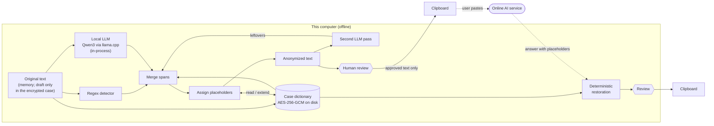

# Privacy architecture

This document describes how Hajde Ano keeps private case data on the local computer.

## Data flow

* The **original text** is kept in memory and, as an autosaved draft of the case, only
  inside the encrypted case file. It is never written to disk in plaintext.
* The **local LLM** runs in-process through LLamaSharp (llama.cpp). There is no server,
  no localhost port and no external process. The model only returns a JSON list of
  spans; the application checks that each span occurs in the text and performs all
  replacements itself.
* The **anonymized text** reaches the clipboard only after the user confirmed the review
  and resolved every uncertain detection.
* **Restoration** is a deterministic dictionary lookup. Unknown or modified
  placeholders are reported and left unchanged.

## What is stored, and how

| Data | Location | Protection |
|---|---|---|
| Case name, entity dictionary (original values ↔ placeholders), terms marked as not sensitive, the text of the case | `<data dir>/cases/<name>.case` | AES-256-GCM with a random key per case. The file name is a keyed hash (HMAC-SHA256, base64url) of the random case id, so it reveals nothing. The case id is authenticated as associated data, so case files can't be swapped |
| Index: the case ids, the key and the last saved revision of each case | `<data dir>/index` | AES-256-GCM with a key derived from the password key (HKDF) |
| Vault header (salt, iteration count, encrypted verifier) | `<data dir>/vault.json` | Contains no private data. Validated on unlock (bounded iteration count, salt size), so a damaged file is reported instead of crashing or hanging |
| Settings (model path, context size, categories) | `<data dir>/settings.json` | Contains no private data |
| Anonymized documents, AI answers, restored texts | Nowhere | Kept in memory only |

Files and folders are created readable by the user only (mode 0600/0700 on Linux and
macOS). Without the password, one can still see how many cases exist, their sizes and
when they were last changed.

The data directory is the per-user application data folder, e.g. `%APPDATA%\HajdeAno`
on Windows or `~/.config/HajdeAno` on Linux. The exact path is shown in *Settings*. It
can be overridden with `HAJDE_ANO_DATA_DIR`.

### Key management

The encryption key is derived from the user's password with PBKDF2-HMAC-SHA256
(600 000 iterations, 128-bit random salt). The key exists only in memory while the
vault is unlocked and is zeroed when the vault is locked or the application exits.
A lost password cannot be recovered.

The design also allows an OS-protected key (DPAPI on Windows, Keychain on macOS). We
chose a password-derived key because it works the same way on all platforms and
protects the data even against other processes of the same user.

### Writes, autosave and deletion

Every write goes to a temporary file in the same folder, which is flushed to the disk and
then renamed over the old file. A crash or power loss therefore leaves either the old or
the new file, never a mix (an AES-GCM file with a torn write could not be decrypted at
all). Leftover temporary files (ciphertext only) are removed when the vault is unlocked.

The text of the case is saved automatically 1 second after you stop typing, and at least
every 10 seconds while you keep typing, but only if it actually changed. A case file is
a few kilobytes up to some tens of kilobytes, so this is negligible for the disk: a
20 KB case saved every 10 seconds during 8 hours of continuous typing is about 60 MB a
day, while SSDs are rated for hundreds of terabytes written. Writing only the changed part, e.g. in place or through a memory-mapped file, is
not possible: every save is encrypted with a fresh nonce, so the whole ciphertext
changes, and in-place writes would lose the crash safety of the rename. A database such
as SQLite would not write less either (it writes whole pages plus a journal), and would
leave old versions of the text in free pages and the journal.

**Rollback.** Each save increments the revision of the case, which is recorded in the
encrypted index. If an older copy of a case file is put back (from a backup or by
someone with access to the folder), it is detected and not loaded. Rolling back the
whole folder consistently (index and cases together) cannot be detected without a
trusted external counter.

**Deletion.** Deleting a case first removes its random key from the index, then
overwrites the case file with random bytes and deletes it. Any copy of the case file
left behind (in free SSD blocks, file system snapshots or backups) can no longer be
decrypted with the current vault. Copies of *old* index files left behind on the disk
could still contain the key; overwriting is best effort on SSDs and copy-on-write file
systems, so use full-disk encryption as well.

## Offline guarantees

* The application contains no networking code. `dev/continuous_integration/check_offline.py`
  (run by the pre-commit script and in CI) fails if `src/` mentions HTTP clients,
  sockets, DNS, process spawning, telemetry or logging frameworks.
* If no model is found, the application shows a local error message and asks the user
  to select a file. It never downloads one.
* llama.cpp logging is disabled through a no-op log callback, so prompts are never
  printed.
* Errors in the user interface are caught and shown with their type only. An unhandled
  exception elsewhere ends the program with a one-line message naming only the
  exception *type*; the program exits instead of aborting, so the runtime prints no
  details and no core dump is written. There is no crash reporter.
* .NET itself sends no runtime telemetry. The .NET *SDK* and Avalonia's build services
  have build-time telemetry, which only matters on developer machines; it is disabled
  in `Directory.Build.targets`, by all dev scripts and in CI (see CONTRIBUTING.md).
* The developer CLI never writes the dictionary (names ↔ placeholders) unencrypted; it
  encrypts it with a password (AES-256-GCM, PBKDF2-HMAC-SHA256).

To verify network isolation yourself, run the application with networking disabled,
e.g. `unshare -rn ./HajdeAno` on Linux or under a firewall rule that blocks the
executable on Windows and macOS. All features keep working.

## Remaining risks

* **Detection is probabilistic.** The model can miss names, especially rare ones or
  ones in unusual contexts. Mitigations: deterministic patterns, the case dictionary
  with fuzzy matching, a second pass over the anonymized text, recall-oriented prompts,
  and mandatory human review.
* **Clipboard.** Copied text is visible to other applications and to clipboard history
  tools (e.g. Windows clipboard history), and clipboard sync can carry it to other
  devices. Only approved anonymized text and restored text are copied, at the user's
  explicit request. Restored text contains the original names.
* **Save as.** *Save as…* on the input screen exports the original text unencrypted to a
  file you choose, outside the vault. Likewise, *Save restored Word document…* writes
  the restored answer, with the original names, unencrypted. Everything else is saved
  encrypted.
* **Swap and memory dumps.** Text in memory can be paged out by the operating system.
  Use full-disk encryption.
* **Indirect identifiers.** Even without names, a combination of details (rare
  diagnosis, small village, unusual events) can identify a person. Strict privacy mode
  replaces dates, amounts, nationalities and places, but the user remains responsible
  for the final text.
